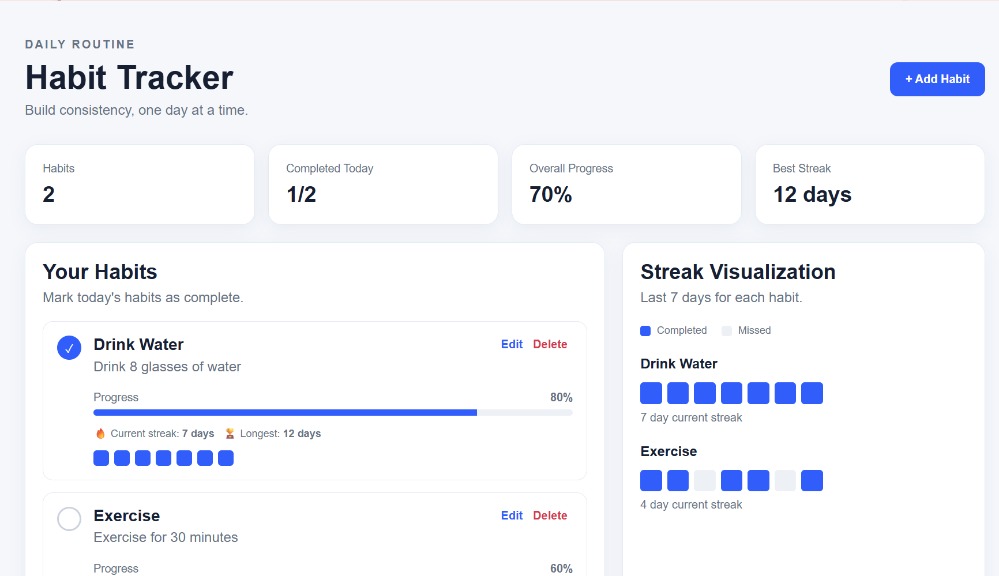
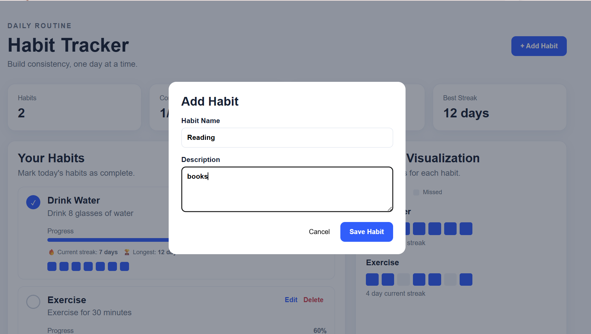
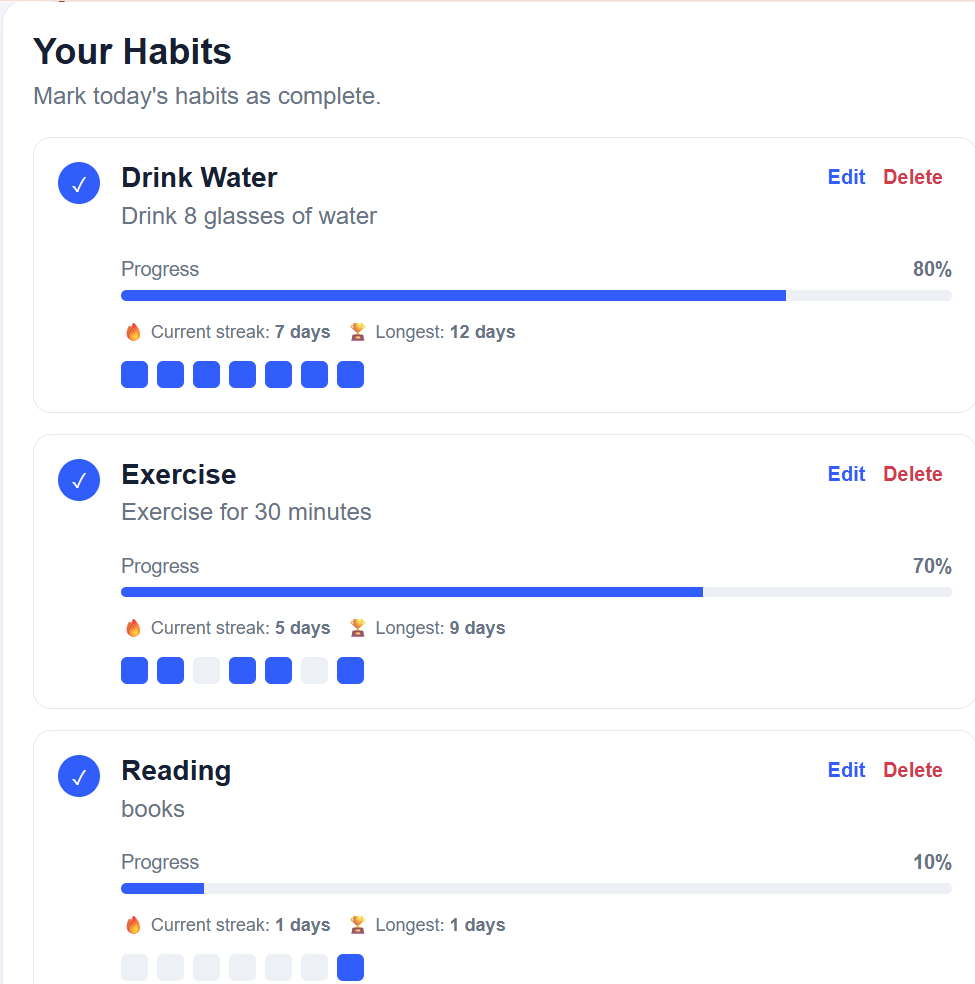

# Habit-Tracker
# Habit Tracker

A simple and responsive **Habit Tracker** web application that helps users create habits, track daily completion, monitor progress, and visualize streaks.

## 📸 Screenshots

### Dashboard



### Add Habit



### Habit Progress and Streaks



## ✨ Features

- Add new habits
- Edit existing habits
- Delete habits
- Mark habits as completed for the day
- Track individual habit progress
- View current streaks
- View longest streaks
- 7-day streak visualization
- Overall progress dashboard
- Responsive user interface

## 🛠️ Technologies Used

### Frontend
- React
- Vite
- JavaScript
- CSS

### Backend
- Node.js
- Express.js
- MongoDB
- Mongoose
- CORS
- dotenv

## 📁 Project Structure

```text
habit-tracker/
├── README.md
├── client/
│   ├── index.html
│   ├── package.json
│   └── src/
│       ├── App.jsx
│       ├── index.css
│       └── main.jsx
├── server/
│   ├── package.json
│   ├── server.js
│   └── .env.example
└── screenshots/
    ├── dashboard.png
    ├── add-habit.png
    └── habit-streak.png
```

## 🚀 How to Run the Project

### 1. Start MongoDB

Make sure MongoDB is installed and running on your computer.

The application uses:

```text
mongodb://127.0.0.1:27017/habit_tracker
```

### 2. Start the Backend

Open a terminal:

```bash
cd server
npm install
npm run dev
```

The backend runs on:

```text
http://localhost:5000
```

### 3. Start the Frontend

Open a second terminal:

```bash
cd client
npm install
npm run dev
```

The frontend runs on:

```text
http://localhost:3000
```

Open the frontend URL in your browser.

## 🔌 API Endpoints

| Method | Endpoint | Description |
|---|---|---|
| GET | `/api/habits` | Get all habits |
| POST | `/api/habits` | Create a habit |
| PUT | `/api/habits/:id` | Update a habit |
| DELETE | `/api/habits/:id` | Delete a habit |
| POST | `/api/habits/:id/complete` | Mark a habit as completed |
| GET | `/api/habits/:id/progress` | Get habit progress |

## 📊 Habit Tracking

Each habit can display:

- Completion status
- Progress percentage
- Current streak
- Longest streak
- Seven-day completion visualization

## 🎯 Purpose

The project was developed to demonstrate a practical habit-management application using a modern React frontend, Node.js/Express backend, and MongoDB database.
